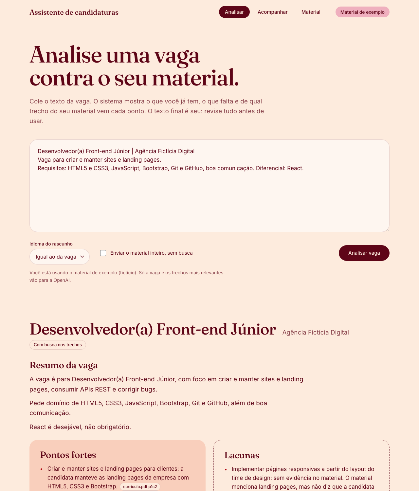
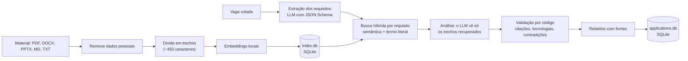
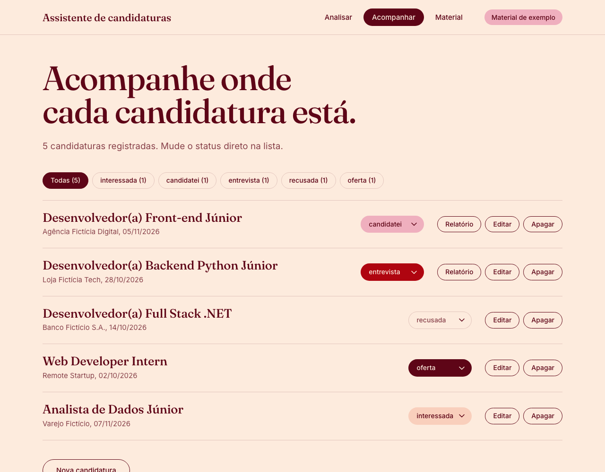

# Assistente de candidaturas (LLM + RAG)


Você cola o texto de uma vaga. O sistema extrai os requisitos, busca no **seu** material (currículo, projetos, apresentações, respostas anteriores) os trechos relevantes e devolve: resumo da vaga, pontos fortes, lacunas, o que destacar no currículo e um rascunho de mensagem. **Cada afirmação cita o trecho de onde veio.** Depois, registra a candidatura.



**Objetivo:** ser uma ferramenta para analisar se o meu currículo faz sentido para uma vaga e adaptá-lo. O sistema mostra o que o meu material já comprova, o que falta e o que vale destacar, sem inventar nada que eu não tenha feito.

Projeto de portfólio feito com Spec-Driven Development ([especificação](docs/spec.md), [plano](docs/plan.md), [tarefas](docs/tasks.md)) e depois **avaliado com método**: quatro avaliações medem a busca, a fundamentação das respostas e a escala, e três delas apontaram defeitos reais que eu corrigi. Elas estão resumidas abaixo, **inclusive onde o resultado foi inconclusivo**.

## O problema e as regras

Assistentes de IA tendem a "melhorar" o currículo: inventam uma tecnologia, arredondam 6 meses para 1 ano. Numa candidatura isso é pior que não ajudar. As regras do projeto:

1. **Nunca inventar** experiência, tecnologia ou resultado. Sem informação, o relatório diz "sem evidência no material".
2. **Toda sugestão cita o trecho de origem** (`[curriculo.pdf#p1c2]`), e o código confere se a citação existe e se a tecnologia citada está escrita no trecho.
3. **O texto final é seu.** Tudo sai como rascunho; o sistema não envia nada a ninguém.
4. **Dados pessoais e chaves ficam fora do repositório** (`.env`, `data/private/`, `*.db` no `.gitignore`).

Veja um [relatório de exemplo](docs/exemplo-relatorio.md) (saída real, sem edição, com material fictício).

## Arquitetura



- **Uma consulta por requisito**, em vez de uma consulta com a vaga inteira: é mais precisa e dá o mapa "requisito → trechos".
- **Busca híbrida:** o modelo local (MiniLM multilíngue) é bom com frases e fraco com nomes soltos, então requisitos de tecnologia ganham bônus quando o trecho contém o termo literalmente (HTML5 casa com "HTML"), e há uma tabela pequena de idiomas (English ≈ Inglês).
- **Validação em código, não só no prompt:** (1) toda citação existe; (2) tecnologia em "Pontos fortes" aparece no trecho citado; (3) item de "Pontos fortes" não diz "sem evidência". Se algo falha, o sistema pede uma correção; se persistir, o código move o item para "Lacunas" e avisa.
- **Sem framework** (LangChain etc.) e **sem banco vetorial**: busca exata em NumPy sobre embeddings guardados em SQLite. O [benchmark de escala](docs/benchmark-escala.md) mostra que isso basta com folga para este uso.
- **Dois arquivos SQLite:** o índice é descartável e se refaz sozinho; as candidaturas não.

## O que as avaliações mostraram

| Avaliação | Pergunta | Resultado principal |
|---|---|---|
| [Fidelidade](docs/avaliacao.md) (7 vagas, 2 modos) | O sistema inventa experiência? | Nenhuma tecnologia de uma palavra ausente chegou a "Pontos fortes". Na 1ª rodada o RAG inventou 5 itens; reforcei a validação |
| [Retrieval](docs/avaliacao-retrieval.md) (108 consultas, 183 trechos) | A busca acha a evidência, e sabe dizer quando não existe? | **A busca híbrida supera a só semântica: +8 pp de Hit@3 (IC 95% de +2 a +14).** Quase todo o resto ficou **inconclusivo** |
| [Fundamentação](docs/avaliacao-fundamentacao.md) (222 afirmações) | Cada afirmação é sustentada pelo trecho que cita? | 80 a 83% totalmente sustentadas, 17 a 20% parciais, **0% julgadas não sustentadas** (pelo juiz, um LLM ainda sem validação humana). RAG contra material inteiro: inconclusivo |
| [Escala](docs/benchmark-escala.md) (1 mil a 200 mil trechos) | Quando a força bruta deixa de bastar? | **O gargalo era reler o SQLite a cada análise, não a busca:** 822 ms para 56 ms em 200 mil trechos com o cache |

**Defeitos reais que a avaliação encontrou:** (1) 9% dos trechos eram só um título solto, que ganhava nota alta na busca; (2) o carregamento do índice custava 14 vezes mais que a busca; (3) o RAG afirmava tecnologias que o perfil não tem. Os três foram corrigidos e têm testes. O efeito medido da correção do chunking foi **pequeno e inconclusivo**, e está escrito assim.

**O que eu aprendi sobre avaliar:**
- Comparar dois intervalos de confiança lado a lado é conservador demais; o **bootstrap pareado** (consulta a consulta) separou "melhor" de "parece melhor".
- A primeira versão do meu benchmark de escala dava recall de 0,33 do HNSW por defeito nos meus dados sintéticos (vizinhos quase empatados). Contei o erro no documento e mantive o pior caso como `--dificil`.
- Minha métrica de fundamentação tratava cortesias do rascunho ("Fico à disposição") como afirmações falsas. Corrigi e escrevi o porquê.
- O juiz de fundamentação é um LLM (`gpt-5.5`, outro modelo que o gerador). **Não foi validado por uma pessoa.** Conferi o juiz contra os rótulos de outro LLM (Claude) em 30 afirmações: 97% de concordância (kappa 0,78), com uma divergência. Isso reduz o risco, mas são dois LLMs; os números significam "o que LLMs acharam", não "o que uma pessoa achou". A amostra para rotular à mão continua disponível.

**Limites das avaliações:** o corpus é **fictício**, gerado por LLM e escrito pela mesma pessoa que escreveu as consultas (viés de autor); medem se o sistema funciona, não se funciona bem no currículo de alguém. Com 64 consultas com evidência e ~110 afirmações por modo, os intervalos são largos.

## Como rodar

Requer **Python 3.10+** e uma **chave da API da OpenAI com crédito**. Cada pessoa usa a própria chave e o próprio currículo: nada disso vem no repositório.

### Passo a passo

**1. Baixe e instale**
```bash
git clone https://github.com/FeFeFarias05/assistente-candidaturas-rag.git
cd assistente-candidaturas-rag
python3 -m venv .venv && source .venv/bin/activate
pip install -r requirements.txt && pip install -e .
```

**2. Coloque a sua chave.** Crie uma chave em [platform.openai.com](https://platform.openai.com/api-keys) (a conta precisa de crédito) e rode:
```bash
cp .env.example .env
```
Abra o `.env` e preencha `OPENAI_API_KEY=` com a sua chave. O `.env` é ignorado pelo Git e a chave nunca sai da sua máquina, a não ser nas chamadas à OpenAI.

**3. Experimente com o material fictício.** Por padrão (`MATERIAL_DIR=data/sample`) o sistema usa um currículo de exemplo, para você ver como funciona sem expor nada seu:
```bash
jobassist analyze eval/jobs/05_frontend_jr_pt.txt
```
Na primeira execução o modelo de embeddings (~220 MB) é baixado para `.cache/`.

**4. Use o seu currículo.** Coloque o seu PDF (com texto selecionável), Word, PowerPoint, `.md` ou `.txt` em `data/private/` e troque no `.env`:
```
MATERIAL_DIR=data/private
```
Essa pasta é ignorada pelo Git. Quanto mais material (projetos, apresentações, respostas anteriores), melhores as análises.

**5. Analise uma vaga.** Salve o texto da vaga em `data/vagas/` (também ignorada) e rode `jobassist analyze data/vagas/minha_vaga.txt`, ou abra a interface web:
```bash
jobassist web --open        # http://127.0.0.1:8765
```
Na web, cole a vaga na tela **Analisar**. A tela **Material** só permite adicionar ou remover arquivos quando `MATERIAL_DIR` aponta para a sua pasta, não para o exemplo.

**O que isso custa e o que sai do seu computador:** cada análise chama a OpenAI com a sua chave e gasta crédito (o terminal mostra os tokens usados). Só o texto da vaga e no máximo 12 trechos de ~450 caracteres do seu material são enviados, e não o currículo inteiro; a busca dos trechos roda no seu computador. Detalhes nos parágrafos **Dados pessoais** e **Privacidade**, abaixo da tabela de comandos.

| Comando | O que faz |
|---|---|
| `jobassist analyze vaga.txt` | Relatório com RAG. Sem o arquivo, cola a vaga no terminal. Salva em `reports/`. Pergunta se registra a candidatura. |
| `jobassist analyze vaga.txt --lang en` | Força o idioma do rascunho (padrão: o da vaga). |
| `jobassist analyze vaga.txt --register candidatei` | Registra sem perguntar. |
| `jobassist analyze vaga.txt --no-rag` | Linha de base: manda o material inteiro no prompt. |
| `jobassist extract vaga.txt` | Só extrai os requisitos (JSON). |
| `jobassist web [--port 8765] [--open]` | Abre a interface web. |
| `jobassist ingest [--rebuild]` | Indexa o material. O `analyze` já faz isso, só do que mudou. |
| `jobassist add EMPRESA TITULO` / `list` | Registra e lista candidaturas. Status: interessada, candidatei, entrevista, recusada, oferta. |
| `jobassist show ID` / `edit ID ...` / `status ID NOVO` / `delete ID` | Abre o relatório, edita, muda o status ou apaga (pergunta antes). |

**Consumo da API:** ao final de cada comando que chama o LLM, o terminal mostra as chamadas e os tokens gastos. Para uma estimativa em dólar, preencha `PRICE_IN_PER_1M` e `PRICE_OUT_PER_1M` no `.env` com os preços da OpenAI para o seu modelo (não embuti preços porque eles mudam).

**Usar o seu material real:** coloque PDF (com texto selecionável), PowerPoint, Word, `.md` ou `.txt` em `data/private/` e ponha `MATERIAL_DIR=data/private` no `.env`. Essa pasta é ignorada pelo Git. Guarde as **vagas** em `data/vagas/` (também ignorada), nunca dentro de `data/private/`: tudo que está na pasta de material é lido como experiência sua.

**Dados pessoais:** antes de indexar ou enviar qualquer coisa, o sistema remove as linhas com endereço, data de nascimento, telefone, CPF e e-mail (Linkedin e GitHub ficam) e avisa quantas removeu. É uma heurística por linha: dados pessoais no meio de um parágrafo não são pegos.

**Privacidade:** os embeddings são locais, então o material completo não sai da máquina. Só a vaga e os trechos recuperados (no máximo 12 de ~450 caracteres) vão ao LLM. Não é "100% privado", e o modo `--no-rag` só roda com material fictício, a menos que você confirme com `--yes-send-all`.

## Interface web

Três telas, com as cores e as fontes de um portfólio pessoal (Fraunces e Inter):

- **Analisar:** mostra pontos fortes e lacunas lado a lado, cada afirmação com uma etiqueta do trecho de origem, e o rascunho com o botão "Copiar sem as citações". Mostra o consumo da API e deixa registrar a candidatura.
- **Acompanhar:** lista as candidaturas, com filtro, mudança de status direto na lista, edição, relatório e exclusão.
- **Material:** lista os arquivos indexados, adiciona, remove e reindexa. Com o material de exemplo ativo, não deixa mexer nos arquivos (a pasta é versionada no Git).



Cuidados de segurança, porque o servidor lê o seu material e usa a sua chave: escuta só em `127.0.0.1` e recusa outro `Host`; toda requisição que altera algo exige um cabeçalho próprio (uma página qualquer aberta no navegador não consegue enviar arquivos nem disparar análises); cabeçalhos de segurança (CSP); e o front-end nunca usa `innerHTML`, porque o relatório vem de um LLM (há um teste que garante isso). É o servidor de desenvolvimento do Flask: serve para uso local, não para expor na internet.

## Reproduzir as avaliações

```bash
pytest                                              # 225 testes, sem chamar a API
python eval/run_eval.py                             # fidelidade, 7 vagas (API)
python eval/retrieval_eval.py [--openai] [--mpnet]  # retrieval (local; --openai gasta centavos)
python eval/grounding_eval.py --judge-model gpt-5.5 # fundamentação (API)
python eval/grounding_eval.py --sample 30           # amostra para você rotular, e depois:
python eval/grounding_eval.py --agreement eval/out/grounding_amostra.csv
pip install -r requirements-bench.txt && python eval/bench_scale.py [--dificil]
python eval/corpus/build_corpus.py                  # refaz o corpus fictício (API)
```

## Decisões (e por quê)

- **Primeiro a versão sem RAG (Dia 2).** Deu uma **linha de base**; sem ela eu não saberia se o RAG ajuda. A avaliação mostrou que, nestes tamanhos de material, **o RAG não melhora a qualidade**: o valor dele aqui é privacidade e custo. O modo continua em `--no-rag`.
- **Embeddings locais por padrão.** Não troquei pelos da OpenAI: o ganho medido foi inconclusivo, e o de privacidade é certo.
- **Não adotei a fusão por posição (RRF)** de busca semântica e por palavras-chave: não melhorou o acerto e destrói a escala absoluta da nota, que é o que permite dizer "sem evidência" (AUC de 0,96 para 0,88).
- **Sem banco vetorial.** A busca exata leva 56 ms para as 20 consultas de uma vaga em 200 mil trechos; um material pessoal tem de dezenas a milhares. A busca aproximada (HNSW) é de 9 a 35 vezes mais rápida, mas o recall variou de 1,00 a 0,26 conforme os dados: só adotaria medindo com embeddings reais.
- **Sem `temperature`**: os modelos GPT-5 só aceitam o padrão. A previsibilidade da extração vem do JSON Schema estrito.

## Limites

- O ponto fraco da busca são os requisitos que **não são nome de tecnologia** (Hit@3 de 60 a 77%, por exemplo "construção de pipelines RAG"). Tecnologias estão resolvidas pelo termo literal.
- **Fundamentação:** 17 a 20% das afirmações são só parcialmente sustentadas, em geral porque juntam dois fatos e citam um trecho que cobre um. O rascunho é a seção mais fraca (50 a 58%).
- A validação pega invenção de **tecnologia de uma palavra** e citação falsa, mas não toda inflação (ex.: "SQL" tratado como "SQL Server"). O texto precisa de revisão humana.
- O LLM varia entre execuções: os números de cada avaliação são de uma execução, não uma média.
- PDF escaneado não é lido (sem OCR), e a ordem do texto de PDFs com caixas e barras laterais pode vir embaralhada. Slides rendem só o texto.
- A interface web é local e de um usuário só: sem login, e as análises rodam uma por vez.

## Fluxo de trabalho (Git)

`main` é a versão estável (só recebe merge da `dev`, marcada com tag); `dev` é a integração; `feature/*` e `fix/*` saem da `dev` e voltam com `git merge --no-ff`. Commits curtos com prefixo (`feat:`, `fix:`, `docs:`, `test:`, `refactor:`). O CI roda os testes a cada push e pull request. Nunca se versiona `.env`, `data/private/`, `data/vagas/`, `*.db` nem `reports/`.

## Estrutura

```
docs/           especificação, plano, tarefas e as quatro avaliações (+ exemplo de relatório, imagens)
src/jobassist/  extract · material · chunking · embed · ingest · retrieve · analyze · tracker · service · llm · cli
                web/ (Flask + interface em HTML, CSS e JS puros)
prompts/        extract.md, analyze.md (editáveis sem tocar no código)
data/sample/    material fictício (versionado) · data/private/ e data/vagas/ (ignorados)
eval/           run_eval.py, retrieval_eval.py, grounding_eval.py, bench_scale.py
                corpus/ (spec + 25 documentos fictícios) · jobs/ · jobs_corpus/ · results*.md
tests/          225 testes (pytest), sem chamar a API
.github/        CI (pytest a cada push e pull request)
```
